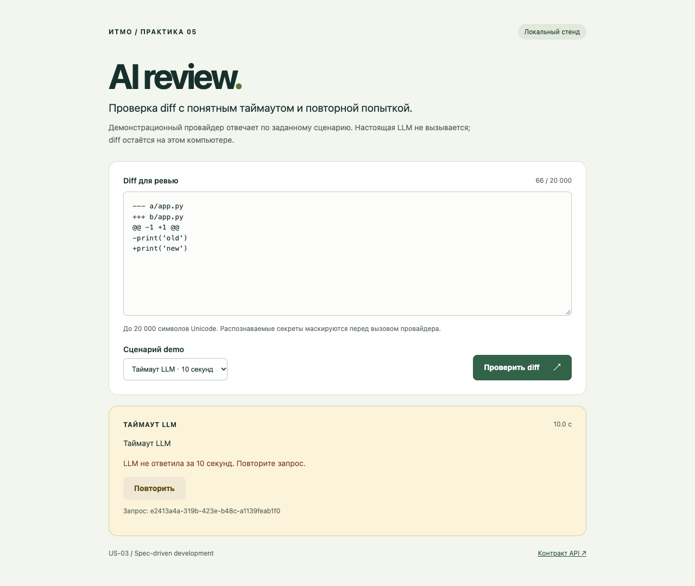

# Практика 5 · Spec-driven development

Домашняя работа: **US-03 — контролируемый таймаут LLM** в сервисе
AI-ревью diff. Готовы локальный FastAPI-сервис, браузерный UI, спецификации
двух команд, общий контракт, тесты, доказательства запуска и сценарий защиты.

## Задание и источник User Story

Учтены описание курса и **слайд 16 [презентации](prenetation.pdf)**:
другой SDD-фреймворк, эмуляция двух команд в отдельных чатах, две спеки
до/после, согласование контракта до кода, реализация UI/логики, проверки,
короткое демо и рефлексия.

В [бэклоге P1](../practice_01/product_management.md) нет нумерации US;
третьим записан Scenario «Таймаут LLM». Его обозначаем US-03:
**как разработчик/CI, я хочу получить понятную ошибку, если LLM не ответила
за 10 секунд, чтобы запрос не зависал и его можно было повторить.**
Первые два сценария (успех и слишком длинный diff) проверены как регрессии.

Исходный AI-review backend существовал только как
[учебный патч](../practice_01/TRAINING_PR.diff), поэтому baseline
восстановлен из его context/added lines с заменой импорта зависимости на
локальный stub. Проект подписок из P3 к этой User Story не относится.
Файлы предыдущих практик не изменялись.

## Быстрый запуск

Нужны **Python 3.11+** (проверено на 3.12.14), Make и интернет только для
установки пакетов. Node, ключи LLM, Docker и БД для сервиса не нужны.

```bash
cd practices/practice_05
make install PYTHON=python3.12
make test
make run
```

Открыть **http://127.0.0.1:8005/**. OpenAPI: **http://127.0.0.1:8005/docs**.
Остановка foreground-сервиса — `Ctrl+C`; другой порт: `make run PORT=8015`.
Если Python 3.11+ доступен как `python3`, параметр `PYTHON` можно опустить.

Вместо pip можно использовать установленный `uv`:

```bash
uv venv --python 3.12 .venv
uv pip install --python .venv/bin/python -r requirements.txt
make run
```

**DemoProvider детерминированный:** реальная LLM не вызывается.
Переключатель сценария позволяет воспроизвести успех, настоящий timeout
10 секунд, недоступность провайдера и невалидный ответ. Это проверка
надёжности сервиса; качество AI-ревью не оценивается. Для подключения
провайдера предусмотрен асинхронный `LLM` Protocol.

## Проверки и демо

```bash
make test                 # unit + ASGI API, без открытого порта
make spec-check           # настоящий prerequisite check Spec Kit
make smoke                # против уже запущенного сервиса, около 10 секунд
make baseline             # воспроизводит исходное поведение учебного патча
make install-dev PYTHON=python3.12
make e2e                  # сам запускает временный HTTP-сервис и браузер
make check                # spec-check + test + e2e
```

E2E использует установленный Chrome/Chromium. При другом пути:
`CHROME_PATH=/путь/к/chrome make e2e`. Если браузера нет:
`.venv/bin/python -m playwright install chromium`.
Пакеты прямых зависимостей закреплены в requirements*.txt; полный снимок
проверенного окружения — [requirements-lock.txt](requirements-lock.txt).
Для точного воспроизведения: `uv pip install --python .venv/bin/python -r requirements-lock.txt`.

Короткая защита — [DEMO.md](DEMO.md). Автоматический E2E проверяет success
→ loading → 504 → ручной retry → success, а также ошибки, Unicode-границу,
вывод HTML как текста, сетевой сбой и мобильный экран.

## Spec Kit вместо OpenSpec

Использован **GitHub Spec Kit / specify-cli 0.12.11**. CLI реально
установлен локально и выполнены init, version и check-prerequisites.
Workflow-инструкции поставлены CLI в `.opencode/commands/`, официальные
шаблоны и скрипты — в `.specify/`. Команды `speckit.*` — инструкции
coding agent, а не shell-команды генерации кода. Этапы выполнены агентами
с явными артефактами; внешний OpenCode-процесс не запускался.

```bash
.venv/bin/specify init --here --force --integration opencode --script sh --ignore-agent-tools
.venv/bin/specify version
make spec-check
```

Команда init приведена для воспроизведения инфраструктуры; повторять её
поверх готовой работы не требуется. Пользовательская constitution сохранена
отдельно перед init и восстановлена после него. Скрипт Spec Kit работает
в подкаталоге монорепозитория без смены Git-ветки, через
`SPECIFY_FEATURE_DIRECTORY=specs/003-llm-timeout`.

| Аспект | OpenSpec в презентации | Spec Kit в работе |
|---|---|---|
| Изменение | changes / proposal / delta specs | feature directory с spec/plan/tasks |
| Постоянные правила | config.yaml, rules.design/specs | .specify/memory/constitution.md |
| Этапы | explore → propose → apply → verify → sync/archive | constitution → specify → clarify → plan → tasks → implement → analyze |
| CLI | instructions/status/validate | init/version + scripts/check-prerequisites |
| Обновление требований | change + sync main specs | правка feature spec/contract и review-amendment |
| Завершение | archive после приёмки | review-ready пакет; человеческая приёмка не имитируется |

Документация: [Spec Kit installation](https://github.github.com/spec-kit/installation.html),
[core commands](https://github.github.com/spec-kit/reference/core.html),
[официальный репозиторий](https://github.com/github/spec-kit).
Сравнение относится к применённому workflow и установленным файлам.

## Две команды и новые правила

UI и логика подготовлены **двумя отдельными агентами** до реализации:

| Этап | UI | Логика |
|---|---|---|
| Независимый черновик | [ui.before.md](specs/003-llm-timeout/drafts/ui.before.md) | [logic.before.md](specs/003-llm-timeout/drafts/logic.before.md) |
| Журнал отдельной сессии | [UI session](evidence/ui-spec-session.md) | [Logic session](evidence/logic-spec-session.md) |
| После согласования | [ui.spec.md](specs/003-llm-timeout/ui.spec.md) | [logic.spec.md](specs/003-llm-timeout/logic.spec.md) |

Общие решения: [contract](specs/003-llm-timeout/contracts/api.md),
[clarifications](specs/003-llm-timeout/clarifications.md).
Фактический diff редакций — [spec-alignment.diff](evidence/spec-alignment.diff).
Зафиксированы 504, envelope ошибки, request_id, demo header, Unicode
code points, ручной retry и разные дедлайны сервера/браузера.

Новые правила заданы в [constitution](.specify/memory/constitution.md):
spec first, test first, library first, async cancellation, интеграционные
проверки, Makefile, Mermaid в design, Given/When/Then в спеках.
Их применение видно в [plan](specs/003-llm-timeout/plan.md),
[spec](specs/003-llm-timeout/spec.md) и red/green отчётах.
Снимок спецификаций **до создания app/** с временем и SHA-256 сохранён
в [spec-before-code.json](evidence/spec-before-code.json); точные исходные
файлы — в `evidence/spec-before-code/`.

## Реализация и контракт

- `GET /` — UI; `GET /health` — health; `GET /api/config` — demo-параметры.
- `POST /api/reviews`, JSON `{"diff":"..."}` — 200 summary/risks/checks.
- 20001 Unicode code points → 413; невалидный ввод → 422.
- Медленный провайдер → 504 llm_timeout; исключение/сломанный ответ → 502.
- `X-Demo-Scenario: normal|slow|error|invalid`; default normal.
- `X-Request-ID` во всех ответах; ошибка содержит тот же request_id в теле.

`ReviewService` маскирует известные формы секретов, ожидает async provider
через `asyncio.wait_for`, отменяет coroutine по дедлайну и проверяет OUT-1
строгой моделью. Отмена запроса не поглощается. UI не исполняет HTML ответа,
сохраняет diff при ошибке и блокирует дубликаты во время loading.
Журнал содержит только request_id/duration/status; access log выключен.

## Результаты и сдача

Фактические результаты: **39 unit/API tests**, **9 browser checks**,
реальный серверный timeout около 10 секунд, успешный retry и smoke
запущенного сервиса. Подробности: [REPORT.md](REPORT.md),
[независимое ревью](evidence/independent-review.md), [reflection](reflection.md).

| Требование слайда 16 | Что показывать |
|---|---|
| Другой SDD-фреймворк, 2 балла | Spec Kit инфраструктура, CLI logs, сравнение выше |
| Две согласованные спеки, 2 балла | before/after, общий контракт, два session log, snapshot до кода |
| Рабочие UI/логика и проверки, 5 баллов | make run/test/e2e/smoke, app/, tests/, evidence/ |
| Рефлексия, 1 балл | reflection.md |

Ограничения: cooperative cancellation требует неблокирующего провайдера;
regex-маскировка не распознаёт произвольный неизвестный секрет; demo не
оценивает качество LLM. Работа готова к человеческому ревью; утверждения
о приёмке преподавателем или студентом не делались.


