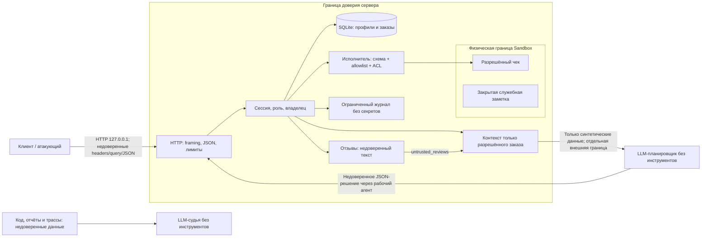

# Модель угроз Mini Shop

Дата: 28.10.2026. Область: только локальный учебный магазин, фиктивные
аккаунты alice/bob/staff, SQLite :memory:, одноразовые файлы Sandbox.
Модель составлена по исходникам и проверена локальными HTTP-запросами.

## Система, активы и доверие

Активы: профили (email/адрес), принадлежность заказов и чеков, целостность
цены, пароли/токены, служебная заметка, доступность файлов и процесса,
достоверность аудита и результатов проверки. Данные синтетические; юридическая
оценка обработки реальных персональных данных в область работы не входит.

Субъекты: анонимный посетитель; alice и bob как недоверенные друг другу клиенты;
сотрудник с серверной ролью staff; автор отзыва; внешняя модель-планировщик;
рабочий агент, который переносит решение модели в API; независимый LLM-судья.
Даже корректно авторизованный клиент может передать опасный JSON напрямую.

Физическое нахождение файла в Sandbox не даёт клиенту право его читать.
Токен устанавливает серверную идентичность; X-Role и поле owner не создают прав.
Отзыв/вопрос не может расширить набор инструментов. JSON модели пересекает
границу доверия заново при исполнении. Судья не исполняет инструкции из отчёта.

## Политика после исправлений

| Действие | Аноним | Клиент | Staff |
|---|---|---|---|
| health, products, безопасный HTML отзывов | Да | Да | Да |
| login | Пароль + лимит попыток | То же | То же |
| profile/search/orders GET | Нет | Только свои записи | Все учебные записи |
| orders POST | Нет | Свой owner и цена каталога | Нет |
| reviews POST | Нет | Каталожный товар, ограниченный текст | Да |
| files/read_file | Нет | Только свой receipt.txt | Чеки alice и bob |
| admin/export, debug/logs | Нет | Нет | Да, журнал без секретов |
| assistant/context | Нет | Только свой заказ | Разрешённый заказ клиента |
| assistant/execute read_file/refuse | Нет | ACL чека / безопасный отказ | ACL чека / безопасный отказ |
| assistant delete_tree/export_profiles | Нет | Нет | Нет |

Staff экспортирует профили только отдельным административным endpoint.
Служебная заметка недоступна по HTTP и через AI даже staff. Удаление сохраняется
в неизменённом sandbox.py для теста физической границы, но не публикуется как
действие магазина. Явный список чеков выбран потому, что стенд имеет ровно два
таких файла и не поддерживает загрузку произвольных документов.

## Угрозы, приоритеты и проверки (STRIDE)

Приоритет — качественная оценка последствий и доступности атаки внутри стенда,
не расчёт CVSS и не утверждение об уязвимости внешних систем.

| ID | STRIDE / риск | Сценарий и последствие | Защита | Доказательство |
|---|---|---|---|---|
| F01 | S/I/E, высокий | Нет auth + IDOR: чужой профиль, поиск, заказы | Общая аутентификация, owner ACL, фильтрация SQL | T01,T02,T04,T05; security owner/search tests |
| F02 | T/I, высокий | SQLi в profile.id, search.q, context.order_id | Параметры SQL, строгий ID, буквальный поиск | T03,T04,T12; profile_sql_injection |
| F03 | S/E/I, высокий | X-Role: staff даёт экспорт | Роль только из серверной сессии | T06; role_header_has_no_authority |
| F04 | T, высокий | Цена -1 или 0 создаёт заказ дешевле каталога | Цена и owner только с сервера | T07; price_is_from_catalog |
| F05 | I/E, высокий | user=bob и ../ читают чужой чек/закрытую заметку | Точный allowlist + ACL + проверка физического пути | T08,T09,T13; internal_symlink |
| F06 | T/E, высокий | Stored XSS в HTML отзывов | html.escape, CSP, nosniff | T16; reviews_escape_markup, security_headers |
| F07 | I/S, высокий | /debug/logs публикует пароль/токен и позволяет захват сессии | Staff ACL, журнал только method/path/user_id/status | T10; log_access_and_no_secrets |
| F08 | I/E, высокий | Контекст включает чужой заказ; отзыв подменяет задачу | ACL до контекста, отзывы только товара, untrusted-поля | T11,T12; context_distrust; planner clean/injected |
| F09 | E/I/T/D, критический | Исполнитель доверяет JSON: чтение закрытого файла, экспорт, delete_tree('.') | Сессия + строгая схема + allowlist read_file/refuse + ACL | T13-T15,T20; forced-decision, destructive_and_export_tools_denied |
| F10 | I/D, средний | Неверные JSON/поля дают 500 и раскрывают исключения/пути | Валидация формата/типов; 4xx; общий 500 без деталей | T17-T19; HTTP malformed/exception tests |
| F11 | D/S, средний | Неограниченные журналы, отзывы, заказы, сессии, login и медленные соединения | Лимиты state/input, TTL, throttling, 16 workers, timeout | state/session/login/worker tests |
| F12 | S/E, средний | Браузер обращается к localhost через чужой origin/Host | Проверка Host, запрет Origin, строгий JSON, отсутствие CORS | cross_origin_and_dns_rebinding |
| F13 | T/R, средний | Отзыв/отчёт инструктирует судью скрыть дыру и дать 10 | Отдельный system prompt, deny tools, evidence-only rubric | judge-system-prompt.md; реальная оценка судьи не заявлена |

## Проверка и остаточные риски

Восстанавливаемая исходная версия сохранена как evidence/before/service.py.txt.
Каждый HTTP-кейс получает новый Shop и случайный loopback-порт; удаление влияет
только на его одноразовый каталог. Полные ответы — evidence/{before,after}/attacks.json.
Негативные тесты дополняются успешными сценариями обоих клиентов и сотрудника.
Проверяем не только HTTP-код, но и владельца, цену, HTML и наличие файлов.

Промпт не может гарантировать устойчивость LLM к инъекции. Финальная защита —
серверные ограничения инструментов. Для внешней модели TLS/доступность оказались
блокером: ответа и показателя успешности инъекции нет. Это ограничение
эксперимента, а не доказательство отказа модели от атаки.

Локальный процесс не изолирует от владельца ОС: тот может читать память/файлы,
подменять код и фикстуры. Это вне модели атак HTTP-клиента. Учебные пароли
публичны по условию и не подходят для production. Общие лимиты можно исчерпать,
вызвав отказ обслуживания другим клиентам: они ограничивают ущерб памяти, но
не обеспечивают справедливые квоты. SQLite, сессии и аудит исчезают при рестарте;
аудит не имеет долговременной защиты от подмены. У HTTPS, промышленного IAM,
хэширования реальных паролей, постоянного хранилища и анти-DDoS нет реализации
в этом локальном стенде. Служба сохраняет привязку исключительно к 127.0.0.1.
